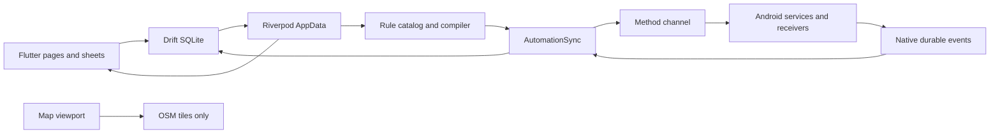

# FrekiHub app documentation

This is the current product and implementation reference, reviewed on 2026-10-02 from `f91f75e`. It is written for maintainers and new agent sessions. Follow [Agent instructions](../AGENTS.md) when making changes.

## Product and scope

FrekiHub records session time, personal income/expenses/savings, recurring finance plans, optional activity/location logs and local Android automations. It opens into Today without an account, server connection or sample records. Core storage and calculations work locally. The basemap requires network tiles; there is no remote record synchronization or currency conversion.

The current work targets Android 15 (API 35) or newer, matching the minimum declared by HyperIsland ToolKit 0.4.0, including Xiaomi HyperOS integration where supported. Legacy iOS ActivityKit sources remain in the repository but were not built or tested in this audit. Their presence does not imply Android location, purchase or reminder features work on iOS.

## Pages and navigation

`AppShell` manages six page surfaces inside one `/` GoRouter route. Page indices are implementation details; target strings are automation compatibility contracts.

| Index | Visible name | Entry | Widget / target |
| --- | --- | --- | --- |
| 0 | Today | Bottom tab | `TodayScreen` / `session_page` |
| 1 | Map | Bottom tab | `MapScreen` / `map_page` |
| 2 | Sessions | Bottom tab | `HistoryScreen` / `sessions_page` |
| 3 | Finance | Bottom tab | `BudgetScreen` / `budget_page` |
| 4 | Settings | Fixed upper-right circle | `SettingsScreen` / `settings_page` |
| 5 | Calendar | Fixed upper-left circle | `CalendarScreen` / `calendar_page` |

Calendar and Settings toggle back to the last bottom tab. Navigation uses direction-aware slide/fade transitions and an elastic selected pill. Outgoing pages ignore touches and pause tickers during the transition. This is an `AnimatedSwitcher`, not an always-mounted tab stack; screen-local selections may reset on leaving a page. Persisted preferences and database records survive. Do not assume Android Back represents a stack of tab changes.

Hold the bottom center to reveal quick-add actions, drag over an action and release to choose it; releasing outside cancels. Actions cover session/log entry, expense, income, savings and finance planner rules. The shared navigation also exposes accessible quick-add actions. There is no central plus tab.

## Today and active sessions

Today shows the analog clock, a split-flap elapsed timer, session note input, clock-in/out control, current-day totals, recent records and an informational offline state. Timer digits update separately from the page; unchanged digits do not animate. The analog clock has a repaint boundary. Reduced motion suppresses the clock/flip transitions and uses immediate updates.

Today's compact centered heading and date stay fixed between the floating Calendar/Settings shortcuts, outside the scrolling content viewport. Its fitted balance pill scrolls with the content and shows all-time recorded income minus expenses and savings in the selected currency, with the same value exposed as `budget.balance`. While idle, the flip display shows live device time including seconds and respects the 12/24-hour preference; during a session it shows elapsed time. Today's recorded total remains separate. Page-top add buttons are removed; the bottom long-press quick-add gesture and context-specific inline add actions remain available.

Manual clock-in creates an OJT session through `AppDatabase.clockIn`. It rejects an existing running session or any session already assigned to today's date. This is stricter than the database's one-running-session constraint: manual forms and native automatic imports use other write paths and can create multiple completed records on one day. Preserve that distinction or deliberately change it across paths.

The timestamp is authoritative for duration; a ticking Flutter widget is not the source of elapsed time. Android's foreground chronometer uses the original start instant. A system notification clock-out stores an exact pending end instant and Flutter reconciles it later. Automatic records use notes beginning `Automatic · PLACE`; visible condition links currently derive the location name from that note, so changing the note can remove the shortcut.

Session forms support OJT, Work, Study and Personal, editable date/start/end/note, wheel time/date input and saved/running records. End must follow start; a running session cannot start in the future. There is no account-level attendance synchronization.

## Sessions

Sessions defaults to a phone list with an optional table. Search includes date, type, note and formatted date. Expandable filters cover month, type, weekday and note presence; sorting exposes column and direction. Stable timestamp/ID tie-breaks avoid arbitrary equal-value order.

The list has its own bounded vertical scrolling viewport. The table uses separate horizontal scrolling, six columns, remembered widths, adjacent-column resizing and double-tap width reset. It does not currently use pinch-to-zoom. Bulk deletion is confirmed; deleted IDs and invalid filter values are pruned. Date/time formatting preferences affect session display and previews.

## Finance

Finance shows selected-month income, expenses, savings, net, safe-to-spend, elapsed-month progress, savings goal, category charts, planner rules and a combined expected/actual timeline. All totals and finance projections use the selected display currency. Existing records keep their own currency; selecting a currency does not convert values.

Transactions store `income`, `expense` or `savings`, amount, currency, category, payment method, note and optional planner occurrence identity. Planner rules are the `rules` database table, not the Settings automation JSON. They support fixed or percentage bases, quantity, once/daily/weekly/monthly cadence, start/end dates, reorder and duplicate actions.

`project` calculates occurrences. Monthly plans clamp their anchor day to a shorter month's last day. Percentage bases are actual income, expenses or non-negative income minus expenses in the occurrence month. A completed occurrence is linked by a unique `ruleId:yyyy-MM-dd` transaction key. Removing the transaction makes that occurrence actionable again. Skip/cancel preferences affect one occurrence, not future repeats.

Safe-to-spend is `max(0, actual net − planned non-income commitments on or after today in the selected period)`. Future planned income is not spendable. For exact calculations and storage types, read [Data reference](DATA_REFERENCE.md).

Detected payment notifications use a conservative local parser. Valid purchases become ordinary editable expense entries after Flutter imports the native queue. A separate confirmation posts only after the database commit. This is not direct bank integration, item recognition or server-side AI summarization.

## Calendar

Calendar is the fixed upper-left shortcut. Its local toolbar switches Year, Month, Week and Day views and shifts the date. Inline agenda add controls retain selected-date entry creation. The Sunday-first calendar differs from the Map's Monday-start week filter.

The year view shows twelve months. Month view uses recorded markers or labels and a draggable collapse handle that reduces to the selected week. Week view has a 24-hour session grid and a finance band; Day view has a visual cover and recorded session/finance agenda. Records are real saved data, not the gaming events in the original reference screenshots. Calendar records retain original currency denominations.

Sessions and entries are indexed by date when their record lists change. The selected date/view are exported as rule context. The separate day panel remembers a bounded extent, with debounced persistence. Initial Calendar selection/view currently start at today/month when remounted; exported preferences should not be mistaken for complete view-state restoration.

## Map

Map fills the content area behind fixed glass controls. Pan, pinch and zoom controls change the viewport; Fit centers the selected records or all filtered records. Category chips are a named/icon/color legend: blue Sessions, green Finance, amber Locations and purple Other. Unknown future located actions remain visible in Other.

Timeline modes are day, Monday-start week, month, year and custom inclusive date range. Queries use local calendar boundaries with an exclusive end and do not apply the Logs sheet's 1,000-row cap. Custom selection uses existing wheel pickers. Changing the range clears the selection; view date/period/trace preferences persist.

`MapRecord.parse` accepts direct or nested JSON positions, validates finite latitude/longitude and rejects samples more than two minutes older than the action, or more than one second in its future when a sample timestamp exists. Logs without usable coordinates are not plotted. This is especially important because SQL log triggers retain the position JSON even when its human-readable location is unavailable.

Markers group positions rounded to five decimal places. A dot opens located records with checkboxes and expandable details. No selection traces all category/time-filtered records; a selection limits the chronological trace. Dashed straight lines connect recorded coordinates, not traveled roads or continuous tracking. Opening Map does not request GPS or turn on location logging.

On-demand OpenStreetMap tiles use app identification, visible attribution and a 128 MiB cache configuration. Tile failure leaves saved dots available and displays a message. Viewport context publishes after 500 ms of inactivity; identical raw query rows skip repeated JSON parsing and marker rebuilds. Current shortcomings and long-history limits are listed in [Application audit](APPLICATION_AUDIT.md).

## Settings and bottom sheets

Settings contains Activity logs, Conditions & automation, saved-transaction posting access, notification sounds, appearance, display currency, category/payment-method management, in-app sound effects, export, restore and clear-data controls.

Activity logs and Conditions & automation share `ActivitySheet`, selected by `initialTab`. Logging, location collection and notification scanning default off. Logs show the newest 1,000 records with expandable action/time/location metadata. Full stored history remains available to Map and export. Central triggers log inserts and the initial clock-out, not every edit/delete or every app interaction.

Conditions support a beginner visual named-location token/radius builder and a structured source editor. Radius units are metres, default 150 m, range 100–1,000 m in 50 m steps. A rule may keep a session running or clock out on leaving. One rule has one configured place; arbitrary map polygons or multiple place arguments are not supported by the current grammar.

The code editor provides contextual completion and line/column parser errors. Validate, Run, Stop and new-rule controls use icons with tooltips. Structured Save leaves a rule paused; Run saves/enables it; Stop disables it without ending the current session. The visual save path enables a condition, subject to the global location toggle and permissions. Up to 100 rules can be saved. Full language examples and limits live in [Rule syntax](../RULE_SYNTAX.md).

Notification sounds select Reminders, Saved transactions or Running sessions, then open the Android channel settings. Android owns the actual sound URI/channel choice. This is separate from the app's `sound` toggle for button/session effects. Running-session notifications default quiet.

Backup exports local data as JSON through native sharing. Restore asks for confirmation, rejects files larger than 20 MiB in the UI and replaces validated data in one database transaction. Native timer/automation state is reset/reconfigured through the Settings workflow. Clear-data requires typed confirmation. These are explicitly user-triggered destructive actions, not automatic startup recovery.

## Architecture and ownership

The architecture has three layers: Flutter presentation, Drift data/calculations and native Android runtime. `screens.dart` groups most screens as `part` files, sharing imports and helper functions. These are not standalone libraries: adding an import directly to a part file is invalid. `design.dart` similarly owns the `flip_clock.dart` part.

The native queue and pending receipts are transport state, not rule source. Flutter imports native events transactionally, then acknowledges them. System reminders post from native receivers without a Flutter widget. Flutter toasts and settings/expense changes need reconciliation. [Android runtime](ANDROID_RUNTIME.md) specifies the lifecycle and method-channel contract.

## Source map

| File | Owns |
| --- | --- |
| `lib/main.dart` | Bootstrap, router, theme selectors, shell navigation, lifecycle, foreground reconciliation |
| `lib/startup.dart` | Glass preparation deadline, orbit loader, readiness-driven intro |
| `lib/screens.dart` | Shared screen imports/parts, guarded operations, session tiles and quick add |
| `lib/design.dart` | Design tokens, surfaces/chrome, page layout, motion, navigation, sheets, toasts |
| `lib/controls.dart`, `lib/pickers.dart` | Custom choice sheets/selectors and wheel date/time pickers |
| `lib/today.dart`, `lib/flip_clock.dart` | Today, analog clock and elapsed split-flap display |
| `lib/history.dart`, `lib/calendar.dart`, `lib/budget.dart` | Sessions, calendar and Finance pages |
| `lib/map.dart`, `lib/map_records.dart` | Map UI, filters, selection, freshness and range parsing |
| `lib/settings.dart`, `lib/forms.dart` | Settings, list management, backup/reset, session/entry/planner forms |
| `lib/activity.dart`, `lib/rule_editor.dart` | Logs, visual/structured conditions, completion and Run/Stop UI |
| `lib/rule_language.dart` | Catalog, typed snapshots, bounded lexer/parser/compiler |
| `lib/data.dart`, `lib/data.g.dart` | Schema, triggers, reactive data, money/recurrence, generated Drift code |
| `lib/services.dart`, `lib/theme_reveal.dart` | Method-channel wrapper, feedback and theme reveal |
| `lib/automation_sync.dart` | Native config/snapshot transport, event import, deduplication and receipts |
| `android/.../MainActivity.kt` | Method channel, permission intents, SoundPool, resume hook |
| `android/.../SessionService.kt` | Foreground chronometer, HyperIsland, native pending clock-out |
| `android/.../Automation.kt` | Geofences, location job, durable event queue, boot receiver, purchase listener |
| `android/.../RuleProgram.kt` | Native conditions, fresh context, branch deduplication and scoped actions |
| `android/.../RuleNotifications.kt` | Alarm scheduling, recurrence state and reminder posting |
| `android/.../TransactionNotifications.kt` | Post-commit Finance confirmation and destination |
| `android/.../NotificationSoundSettings.kt` | Android channel settings and sound observations |

Native `android/.../` above means `android/app/src/main/kotlin/com/frekihub/freki_hub/`. Dependencies/assets are declared in `pubspec.yaml`; native dependencies in `android/app/build.gradle.kts`.

## Startup, synchronization and performance

`main` renders before glass preparation. SQLite and graphics readiness run concurrently. Graphics has a six-second fallback deadline; initial data streams have a fifteen-second timeout/Retry state and can still recover on late completion. Loader stage text reflects actual readiness, without a fabricated percentage or minimum delay. Retry does not clear records.

`watchAll` caches the four typed tables independently. Preference updates do not reread all session/entry/planner tables. App theme subscribes to theme/sound changes. The shell reconciles after readiness, on resume and approximately every fifteen seconds while foregrounded; `AutomationSync` coalesces overlapping work.

Records and configuration live locally. Native receivers/services exchange data through SharedPreferences and a method channel; this is not cloud synchronization. The UI runs its own animations, but elapsed time and scheduled reminders do not depend on those animations. Device frame times, cold-start latency and OEM background delivery have not been measured in this audit.

## Design contracts

Keep bundled Geist/Geist Mono, Lucide icons, neutral light/dark surfaces, opaque data cards and liquid glass for fixed chrome. `Surface`, `Chrome`, `PageBody`, `panel`, `toast`, `selectField` and wheel pickers are shared contracts. Standard page headers reserve 80 px for fixed top shortcuts; Today's compact header starts at 16 px with horizontal shortcut clearance. Content leaves bottom navigation clearance and uses bounded readable width.

Motion uses `Motion.duration` and shared curves. Preserve reduced motion, tooltips/semantics, enlarged text, keyboard/inset behavior, minimum touch controls and sound preference. `withFeedback`/`ActionFeedback` provide throttled interaction effects; elapsed ticks do not play sounds. OS permission/share/file/channel dialogs remain OS-owned.

## Extending a feature

1. Choose the existing page/form/data owner; inspect its relevant source and tests.
2. Reuse shared design controls rather than replacing them with default platform dropdowns.
3. Preserve money/date and native event reconciliation invariants.
4. Register meaningful observable fields/types/completion in `RuleCatalog` and snapshots or native context. New preference keys are automatically readable under `settings.*` as strings unless explicitly typed.
5. Register a new target when introducing a new resource. Add modifying actions to compiler and native runtime under the correct target; do not permit arbitrary actions.
6. Keep source, compiled program, live snapshot and outboxes separate. Preserve branch-change deduplication and Run/Stop semantics.
7. Update syntax and affected documentation, run meaningful checks, then commit/push within the user's authorized workflow.

Consult [Development](DEVELOPMENT.md) for targeted checks and [Application audit](APPLICATION_AUDIT.md) before changing a known risky area.
