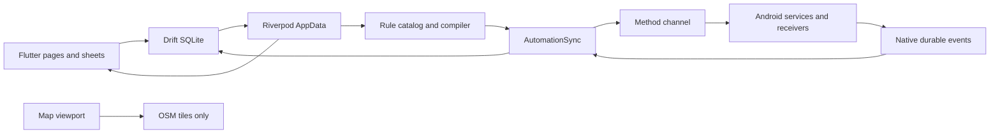

# FrekiHub app documentation

This is the current product and implementation reference, reviewed on 2026-10-02 from `f91f75e`. It is written for maintainers and new agent sessions. Follow [Agent instructions](../AGENTS.md) when making changes.

## Product and scope

FrekiHub records session time, personal income/expenses/savings, recurring finance plans, optional activity/location logs and local Android automations. It opens into Home without an account, server connection or sample records. Core storage and calculations work locally. The basemap requires network tiles; there is no remote record synchronization or currency conversion.

The current work targets Android 15 (API 35) or newer, matching the minimum declared by HyperIsland ToolKit 0.4.0, including Xiaomi HyperOS integration where supported. Legacy iOS ActivityKit sources remain in the repository but were not built or tested in this audit. Their presence does not imply Android location, purchase or reminder features work on iOS.

## Pages and navigation

`AppShell` manages six page surfaces inside one `/` GoRouter route. Page indices are implementation details; target strings are automation compatibility contracts.

| Index | Visible name | Entry | Widget / target |
| --- | --- | --- | --- |
| 0 | Home | Bottom tab | `TodayScreen` / `session_page` |
| 1 | Map | Bottom tab | `MapScreen` / `map_page` |
| 2 | Sessions | Bottom tab | `HistoryScreen` / `sessions_page` |
| 3 | Finance | Bottom tab | `BudgetScreen` / `budget_page` |
| 4 | Settings | Fixed upper-right circle | `SettingsScreen` / `settings_page` |
| 5 | Calendar | Fixed upper-left circle | `CalendarScreen` / `calendar_page` |

Home (formerly Today) uses the Lucide house icon in the bottom tab and the prominent uppercase heading “HOME” without punctuation. Its implementation remains `TodayScreen` in `today.dart`, with the existing `session_page` automation target.

Calendar and Settings toggle back to the last bottom tab. Navigation uses direction-aware slide/fade transitions and an elastic selected pill. Outgoing pages ignore touches and pause tickers during the transition. This is an `AnimatedSwitcher`, not an always-mounted tab stack; screen-local selections may reset on leaving a page. Persisted preferences and database records survive. Do not assume Android Back represents a stack of tab changes.

Hold the bottom center to reveal quick-add actions, drag over an action and release to choose it; releasing outside cancels. Actions cover session/log entry, expense, income, savings and finance planner rules. The shared navigation also exposes accessible quick-add actions. There is no central plus tab.

## Loading presentation

Except initial app launch, pending values and content use `SkeletonValue` and `SkeletonList` from `components.dart`. Static headings, labels and preloaded values remain visible; Map keeps its date while only query-dependent status skeletons. Status text never wraps or adds a row: longer status widens to available clearance and then ellipsizes. `SkeletonValue` retains its child's intrinsic geometry, blocks placeholder interaction, excludes stale value semantics and announces a meaningful pending operation. Its subtle opacity pulse exists only while pending and is static under reduced motion.

Activity logs and Syntax builder use shared record placeholders while data is unavailable. The activity stream shows placeholders before its first snapshot instead of briefly claiming the log is empty. Shared form saves, Home clock actions, syntax location/save/Run operations and active Settings backup/list operations use value/action skeletons while preserving their disabled guards. Loaded content and unrelated controls stay readable. Launch keeps `StartupLoading`; determinate Finance rings/bars continue to visualize real ratios. Future loading UI must follow this policy and reuse these components instead of adding spinners or loading/saving text.

## Home and active sessions

Home shows the analog clock, a split-flap elapsed timer, session note input, clock-in/out control, small live-time caption, recent records and an informational offline state. Timer digits update separately from the page; unchanged digits do not animate. The analog clock has a repaint boundary. Reduced motion suppresses smooth hand/flip transitions while keeping the clock updating once per second. Home samples local device time at second boundaries and immediately on app resume; its date, accessibility time label, elapsed display and live-time caption follow the same sample. Normal-motion analog hands continue moving smoothly between samples. Time changes are sampled again rather than accumulated as timer counts.

Home's compact centered heading uses 28 px bold type with 1.2 px tracking; its heading and date stay fixed between the floating Calendar/Settings shortcuts, outside the scrolling content viewport. Its fitted liquid-glass balance pill begins centered above the clock. As Home scrolls down, the pill follows a smooth scroll-driven path to the upper-right corner, right-aligned with Settings and 9 logical pixels below its 48 px button; scrolling back to the top returns it to the original position. Reduced motion switches positions without the travel animation. Only the pill transform updates on scroll, with its painted content in a repaint boundary and its original space reserved in the list. One balance label remains exposed to accessibility. The pill shows all-time recorded income minus expenses and savings in the selected currency, with the same value exposed as `budget.balance`. While idle, the flip display shows live device time including seconds and respects the 12/24-hour preference; during a session it shows elapsed time. The session card order is round analog clock, small 11 px live device-time line, digital flip display, then the running/ready status. It updates from the same second-boundary sample and follows the 12/24-hour preference, including AM/PM in 12-hour mode. The former daily-total and clock-in timestamp captions are removed. Page-top add buttons are removed; the bottom long-press quick-add gesture and context-specific inline add actions remain available.

The top 28 px of Home's scrolling viewport fades to transparency beneath the fixed header. This uses one static alpha mask, without an animation controller or blur; it does not intercept touches or affect the header. The former bottom privacy reminder card is removed.

Manual clock-in creates an OJT session through `AppDatabase.clockIn`. It rejects an existing running session or any session already assigned to today's date. This is stricter than the database's one-running-session constraint: manual forms and native automatic imports use other write paths and can create multiple completed records on one day. Preserve that distinction or deliberately change it across paths.

With both Activity logging and Location enabled, Home clock actions, session saves, Finance saves/edits and completed Finance occurrences request one foreground location fix through the shared permission hint. A valid fix and the record commit atomically, so Logs and Map see the same position. Denied/unavailable fixes still save the record without a location; backdated session timestamps cannot inherit today's fix. Home captures the confirmed clock instant before optional GPS acquisition, so lookup latency does not add to the session duration. Android Location alone does not enable activity history. See [Location provenance](DATA_REFERENCE.md#activity-logging-and-location-provenance).

Home's manual Clock out action opens an “End this session?” confirmation in the shared adaptive drawer. It previews live elapsed time, session type and the formatted start time. End session and Keep running remain fixed at the bottom; details use the drawer's primary scroll controller. Keep running, Back and barrier dismissal preserve the active session. The sheet includes a multiline Session note field prefilled from the current Home draft. Edits stay local until End session saves the note and clock-out together; Keep running, Back and dismissal discard sheet edits. An empty note is valid. Only explicit confirmation commits the existing note/clock-out transaction. Repeated opening/confirmation is guarded. Opening/closing reuse the shared 250/150 ms motion and reduced-motion behavior. Notification and Dynamic Island Clock out now open a native cross-app confirmation with live duration and an editable note, after opt-in Display over other apps access. Settings includes a designed permission hint and a link to manage access. Cancel/Back keep the session running; confirmed native endings and notes are committed to SQLite when Flutter reconciles. Automation clock-outs retain their existing behavior.

The app-wide `KeyboardOverlay` sits above the Navigator and keeps keyboard insets at zero with persistent safe padding. Android uses `adjustNothing`: the keyboard overlays the existing layout. Pages, navigation, sheets, headers and actions retain their size and position during opening/closing; drawers do not automatically expand. This policy applies to every input, including nested sheets and the syntax editor. Both shell Scaffolds retain full height. `WidthLayoutBuilder` continues caching width-dependent content and refreshes for width, content and inherited theme/accessibility changes.

Home note typing stays in its local controller. Autosave batches changes after a 400 ms pause, skips cursor/selection changes and waits for IME composition to finish. Blur, leaving Home and background lifecycle transitions flush the pending draft; explicit clock-out waits for queued writes before its existing note/end transaction. Writes are serialized and restricted to the captured still-running session. The field has its own repaint boundary so caret/input painting stays isolated. This reduces database/live-data refresh work during typing; it is not a measured device frame-time claim.

The timestamp is authoritative for duration; a ticking Flutter widget is not the source of elapsed time. Android's foreground chronometer uses the original start instant. A system notification clock-out stores an exact pending end instant and Flutter reconciles it later. Automatic records use notes beginning `Automatic · PLACE`; visible condition links currently derive the location name from that note, so changing the note can remove the shortcut.

Session forms support OJT, Work, Study and Personal, editable date/start/end/note, wheel time/date input and saved/running records. Opening a session uses the shared bottom drawer rather than a full-screen container transform. End must follow start; a running session cannot start in the future. There is no account-level attendance synchronization.

## Sessions

Sessions defaults to a phone list with an optional table. Search includes date, type, note and formatted date. Expandable filters cover month, type, weekday and note presence; sorting exposes column and direction. Stable timestamp/ID tie-breaks avoid arbitrary equal-value order.

The list has its own bounded vertical scrolling viewport. The table uses separate horizontal scrolling, six columns, remembered widths, adjacent-column resizing and double-tap width reset. It does not currently use pinch-to-zoom. Bulk deletion is confirmed; deleted IDs and invalid filter values are pruned. Date/time formatting preferences affect session display and previews.

## Finance

Finance shows selected-month income, expenses, savings, net, safe-to-spend, elapsed-month progress, savings goal, category charts, planner rules and a combined expected/actual timeline. All totals and finance projections use the selected display currency. Existing records keep their own currency; selecting a currency does not convert values.

Transactions store `income`, `expense` or `savings`, amount, currency, category, payment method, note and optional planner occurrence identity. Planner rules are the `rules` database table, not the Settings automation JSON. They support fixed or percentage bases, quantity, once/daily/weekly/monthly cadence, start/end dates, reorder and duplicate actions.

`project` calculates occurrences. Monthly plans clamp their anchor day to a shorter month's last day. Percentage bases are actual income, expenses or non-negative income minus expenses in the occurrence month. A completed occurrence is linked by a unique `ruleId:yyyy-MM-dd` transaction key. Removing the transaction makes that occurrence actionable again. Skip/cancel preferences affect one occurrence, not future repeats.

Safe-to-spend is `max(0, actual net − planned non-income commitments on or after today in the selected period)`. Future planned income is not spendable. For exact calculations and storage types, read [Data reference](DATA_REFERENCE.md).

Detected finance notifications use a conservative local parser for selected apps. Clear incoming transactions become ordinary editable income entries; clear outgoing purchases/payments become editable expenses after Flutter imports the native queue. FrekiHub asks for notification-listener access when detection is enabled; permission to post the optional saved-entry confirmation is separate. Confirmations post only after the database commit. This is not direct bank integration, item recognition or server-side AI summarization, and unclear notifications are skipped.

## Calendar

Calendar is the fixed upper-left shortcut. Its local toolbar switches Year, Month, Week and Day views and shifts the date. Inline agenda add controls retain selected-date entry creation. The Sunday-first calendar differs from the Map's Monday-start week filter.

The year view shows twelve months. Month view uses recorded markers or labels and a draggable collapse handle that reduces to the selected week. Week view has a 24-hour session grid and a finance band; Day view has a visual cover and recorded session/finance agenda. Records are real saved data, not the gaming events in the original reference screenshots. Calendar records retain original currency denominations.

Sessions and entries are indexed by date when their record lists change. The selected date/view are exported as rule context. The day agenda uses the shared adaptive drawer, without a nested draggable sheet. The legacy `dayPanel` preference remains in saved/exported data but no longer controls drawer height. Initial Calendar selection/view currently start at today/month when remounted; exported preferences should not be mistaken for complete view-state restoration.

## Map

Map places inline previous/date/next controls between Calendar and Settings at the 16 px top inset. The date controller uses a content-fit glass pill, capped by the space between shortcuts, with the date above a compact 9 px located/unlocated count row at 55% opacity. Minimal vertical padding keeps the normal height near 48 px; status text never wraps or adds another row. Basemap/error notices join the counts on that same line. Record queries replace only the pending status value with the shared SkeletonValue placeholder in its existing layout; the preloaded date stays visible; there is no loading text. Its opacity pulse stops when loaded and remains static with reduced motion. Longer status expands the pill horizontally up to the available shortcut clearance, then truncates with an ellipsis. Status length does not change the pill height or vertical position; legends retain clearance for enlarged text. Previous/next arrows sit at opposite ends with 10 px horizontal edge padding. The separate mode selector is removed; long pressing the pill opens the shared themed choice menu with rounded surfaces, a selected checkmark and reduced-motion-aware transitions. Tapping the date opens the shared date wheel. Timeline logs is a separate 48 px button above the middle-right tools. Fit, trace and zoom controls stack vertically in a glass rail centered on the right edge. The rail can scroll vertically on short viewports. Category legends sit in one horizontal scrolling strip below the top shortcuts: blue Sessions, green Finance, amber Locations and purple Other. Tapping a legend toggles that category. Pan and pinch operate directly on the map; Fit centers selected records or all filtered records. Unknown future located actions remain visible in Other. The lower summary pill is removed. The date range remains available in the upper pill accessibility label and original picker. Counts stay visible while tracing. Loading/basemap notices appear in the upper pill and Retry appears in the right-side tool rail when needed.

Timeline modes are day, Monday-start week, month, year and custom date/time range. Arrows advance one selected day/week/month/year; the compact date label slides and fades for 200 ms, skipped for reduced motion. Custom disables and fades the arrows. Its shared advanced panel edits From/Through dates and an optional start/end time; Apply validates the end follows the start, and Cancel leaves the timeline unchanged. End time includes the selected minute; whole-day ranges include the Through date. Queries use local calendar boundaries with an exclusive end and do not apply the Logs sheet's 1,000-row cap. Custom date/time selection uses existing wheel pickers. Exact boundaries persist as mapFrom/mapUntil ISO instants and are exposed as numeric map.from_epoch/map.until_epoch. Changing the range clears the selection; view date/period/trace preferences persist.

`MapRecord.parse` accepts direct or nested JSON positions, validates finite latitude/longitude and rejects samples more than two minutes older than the action, or more than one second in its future when a sample timestamp exists. Logs without usable coordinates are not plotted. This is especially important because SQL log triggers retain the position JSON even when its human-readable location is unavailable.

Markers group positions rounded to five decimal places. A dot opens compact located log rows with selection checkboxes. No selection traces all category/time-filtered records; a selection limits the chronological trace. Dashed straight lines connect recorded coordinates, not traveled roads or continuous tracking. Opening Map does not request GPS or turn on location logging.

On-demand Geoapify `osm-carto` raster tiles replace the public OpenStreetMap tile server, with app identification, visible Geoapify/OpenStreetMap attribution and a 32 MiB cache configuration. `GEOAPIFY_API_KEY` is a build-time Dart define supplied from Git-ignored local configuration; credentials are not saved in preferences, backups or rule snapshots. Without a configured key, the basemap stays blank with an explanation while recorded dots and log controls remain available. The geocoding search endpoint returns address coordinates and is not used for basemap tiles or to fabricate missing recorded positions. See [Development](DEVELOPMENT.md) for key configuration. Tile failure leaves saved dots available and displays a connection/retry message. Retry resets the tile layer and evicts failed images without disposing its network provider or changing selected records; a saved-record query failure retries that query separately. No saved coordinates in a timeline is an empty state, not a GPS permission error. Opening Map does not request current GPS location.

Controls use compact 18 px icons with labeled tooltips and 48 px touch targets. Trace shows a 43 px theme-aware gray circular background while active inside its 48 px touch target, and exposes its selected state to accessibility. Shared Chrome now has a 94% themed surface backing inside its glass edge, including navigation and fixed Calendar/Settings buttons, so map tiles do not compete with text/icons. Timeline logs also lists records with missing/invalid/stale coordinates; its header explains that only located logs can be selected or traced. Late-arriving first locations fit the camera after an empty initial result. Cancelled range queries cannot overwrite the current view; successful record updates clear earlier query errors. Category chips retain their named/icon/color legend; large grouped dots display `99+` while accessibility labels and their detail drawer retain the full count. Viewport context publishes after 500 ms of inactivity; identical raw query rows skip repeated JSON parsing and marker rebuilds. `map.total_count` and `map.unlocated_count` expose timeline coverage separately from category-filtered `map.visible_count`. Current shortcomings and long-history limits are listed in [Application audit](APPLICATION_AUDIT.md).

The cyan **You** legend identifies a foreground current-location circle, separate from saved log dots and trace counts. Tap the locate tool (`Center on current location`) or the inactive You legend to request one fresh fix through the shared permission gate and Map-specific hint. Granted access skips the hint; cancellation is quiet. The map pans/zooms smoothly to the fix, directly with reduced motion. The isolated `LocationPulse` repaints only its own circle; reduced motion uses a static circle. The You legend toggles the marker without another GPS request; the locate tool refreshes and centers it. Only finite coordinates and nonnegative finite accuracy with samples at most two minutes old (up to one second future tolerance) are accepted. Precise permission is required, but an estimate wider than 100 m is still useful: an accuracy halo and wider camera zoom display its uncertainty. Map uses the dedicated `mapCurrentLocation` lookup across enabled GPS/network/fused providers, checking fresh cache candidates and canceling outstanding one-shot requests after a result or 20-second deadline. Disabled system Location has a distinct message. The marker expires after two minutes and the request is discarded if the page is disposed. No background location, logging toggle or saved activity is enabled. View context exposes marker visibility and sample epoch for rule snapshots; fix coordinates remain in page memory, apart from the existing viewport center context after panning. Actual GPS availability and animation feel require phone review.

## Settings and bottom sheets

The shared `panel` implementation lives in `sheets.dart`, a part of `design.dart`, and is the standard bottom drawer for details, forms, selectors, pickers, confirmations and Settings sheets. Default height fits its contents, capped at 70% of the available viewport. Expanded height is 70%; dragging or swiping downward closes the route. Content-fit default and expanded are predefined snap positions, with a closed extent of zero. For long content, default and expanded coincide. The handle toggles default/expanded on tap and exposes increase, decrease and Close sheet accessibility actions. Opening/closing reuse 250/150 ms transitions; reduced motion skips route/handle transitions. Keyboard appearance leaves the drawer layout and snap position unchanged.

`PanelContent` provides fixed `header` and `footer` slots around one primary scrollable body. Plain content gets the shared scrolling wrapper; pass `PanelContent(scrollable: true)` for an existing lazy ListView. The legacy `panel(scrollable: true)` wrapper supports plain content without slots. The supplied `PrimaryScrollController` coordinates content scrolling with resizing; do not supply an independent controller or nest a draggable sheet. Short content is measured from its laid-out viewport and scroll extent, without intrinsic layout or constructing a second copy. Long lists remain lazy. Content/metrics changes update the default snap height. Empty/loading content stays scrollable. Picker wheels retain their own wheel interaction while surrounding content uses the drawer controller.

Headers, search/filter controls and primary actions stay outside body scrolling. Save/Cancel remain pinned in forms; contextual Delete actions scroll with the form fields. `PanelActions` places two actions side by side on short layouts. `components.dart` owns the reusable `AppButton` (primary, secondary, quiet, saving and destructive-text variants), `PanelActions`, `PanelHeading`, opaque `Surface` cards/containers and liquid-glass `Chrome`. Standard Flutter controls continue to use the shared themes in `Design.theme`; no additional package or parallel styling system is needed.

Settings contains Activity logs, Conditions & automation, saved-transaction posting access, notification sounds, appearance, display currency, category/payment-method management, in-app sound effects, export, restore and clear-data controls.

Activity logs and Syntax builder have separate Settings containers and destinations. `LogsSheet` in `logs.dart` uses the shared drawer solely for logging controls and recorded activity. `SyntaxBuilderScreen` in `syntax_builder.dart` opens as an independent full-screen workspace with a fixed Back/header area, bounded scrolling content and no Logs tab or drawer handle. Back returns to the caller. Session Condition set links open this same workspace with the relevant rule selected. Permission hints, selectors and supporting forms still reuse shared panels. Logging, location collection and notification scanning default off. Logs show the newest 1,000 records. Both Settings activity logs and every Map timeline log type reuse `LogRow` from `components.dart`: title above the full date/time while collapsed. Tapping any row smoothly expands its available action/location, amount, notes, coordinates, accuracy and other metadata below; tapping again collapses it. Reduced motion skips the expansion animation. Trace checkboxes remain independent of expansion. Map retains selection checkboxes for located rows; unlocated rows use the same text layout. Stored metadata remains available to export and automation. Full stored history remains available to Map and export. Central triggers log inserts and the initial clock-out, not every edit/delete or every app interaction.

Conditions support a beginner visual named-location token/radius builder and a structured source editor. Radius units are metres, default 150 m, range 100–1,000 m in 50 m steps. A rule may keep a session running or clock out on leaving. One rule has one configured place; arbitrary map polygons or multiple place arguments are not supported by the current grammar.

The code editor provides contextual completion and line/column parser errors. Validate, Run, Stop and new-rule controls use icons with tooltips. Structured Save leaves a rule paused; Run saves/enables it; Stop disables it without ending the current session. The visual save path enables a condition, subject to the global location toggle and permissions. Up to 100 rules can be saved. Full language examples and limits live in [Rule syntax](../RULE_SYNTAX.md).

Notification sounds select Reminders, Saved transactions or Running sessions, then open the Android channel settings. Android owns the actual sound URI/channel choice. This is separate from the app's `sound` toggle for button/session effects. Running-session notifications default quiet.

Backup exports local data as JSON through native sharing. Restore asks for confirmation, rejects files larger than 20 MiB in the UI and replaces validated data in one database transaction. Native timer/automation state is reset/reconfigured through the Settings workflow. Clear-data requires typed confirmation. These are explicitly user-triggered destructive actions, not automatic startup recovery.

## Architecture and ownership

The architecture has three layers: Flutter presentation, Drift data/calculations and native Android runtime. `screens.dart` groups most screens as `part` files, sharing imports and helper functions. These are not standalone libraries: adding an import directly to a part file is invalid. `design.dart` similarly owns the `flip_clock.dart`, `components.dart` and `sheets.dart` parts.

The native queue and pending receipts are transport state, not rule source. Flutter imports native events transactionally, then acknowledges them. System reminders post from native receivers without a Flutter widget. Flutter toasts and settings/expense changes need reconciliation. [Android runtime](ANDROID_RUNTIME.md) specifies the lifecycle and method-channel contract.

## Deleting activity logs

Expand a record in Settings → Activity logs or Map → Timeline logs, then choose **Delete log**. The shared confirmation explains that only the saved log and its map marker are removed; sessions, Finance entries, logging preferences and pending native actions remain intact. Cancellation is quiet. A committed deletion shows the existing “Log deleted” toast with its trash icon; a failed operation shows the error pill. The action uses shared panel/button/skeleton behavior and disables repeated taps while pending.

Activity rows, Map markers/selection and activity count/latest-action observables refresh after commit. A small internal deleted-ID preference prevents native replay from recreating an intentionally deleted log; it retains no title, location or metadata. Existing JSON backups preserve these IDs. This feature does not request permission or add automated deletion commands.

## Source map

| File | Owns |
| --- | --- |
| `lib/main.dart` | Bootstrap, router, theme selectors, shell navigation, lifecycle, foreground reconciliation |
| `lib/startup.dart` | Glass preparation deadline, orbit loader, readiness-driven intro |
| `lib/screens.dart` | Shared screen imports/parts, guarded operations, session tiles and quick add |
| `lib/design.dart` | Owning design library, tokens/themes, page layout, motion, navigation and toasts |
| `lib/components.dart` | Reusable buttons, action groups, sheet headings, Surface cards/containers and glass Chrome (design part) |
| `lib/sheets.dart` | Universal content-fit/70% drawer, fixed slots, snapping/dismissal and confirmations (design part) |
| `lib/controls.dart`, `lib/pickers.dart` | Custom choice sheets/selectors and wheel date/time pickers |
| `lib/today.dart`, `lib/flip_clock.dart` | Home, analog clock and elapsed split-flap display |
| `lib/history.dart`, `lib/calendar.dart`, `lib/budget.dart` | Sessions, calendar and Finance pages |
| `lib/map.dart`, `lib/map_records.dart` | Map UI, filters, selection, freshness and range parsing |
| `lib/settings.dart`, `lib/forms.dart` | Settings, list management, backup/reset, session/entry/planner forms |
| `lib/logs.dart` | Dedicated activity log drawer and expandable record metadata |
| `lib/syntax_builder.dart`, `lib/rule_editor.dart` | Independent visual/structured automation workspace, completion and Run/Stop UI |
| `lib/rule_language.dart` | Catalog, typed snapshots, bounded lexer/parser/compiler |
| `lib/data.dart`, `lib/data.g.dart` | Schema, triggers, reactive data, money/recurrence, generated Drift code |
| `lib/services.dart`, `lib/theme_reveal.dart` | Method-channel wrapper, feedback and theme reveal |
| `lib/automation_sync.dart` | Native config/snapshot transport, event import, deduplication and receipts |
| `android/.../MainActivity.kt` | Method channel, permission intents, SoundPool, resume hook |
| `android/.../SessionService.kt` | Foreground chronometer, HyperIsland, native pending clock-out |
| `android/.../Automation.kt` | Geofences, location job, durable event queue, boot receiver, purchase listener |
| `android/.../RuleProgram.kt` | Native conditions, fresh context, branch deduplication and scoped actions |
| `android/.../RuleNotifications.kt` | Alarm scheduling, recurrence state and reminder posting |
| `android/.../TransactionNotifications.kt` | Post-commit Finance confirmation and destination |
| `android/.../NotificationSoundSettings.kt` | Android channel settings and sound observations |

Native `android/.../` above means `android/app/src/main/kotlin/com/frekihub/freki_hub/`. Dependencies/assets are declared in `pubspec.yaml`; native dependencies in `android/app/build.gradle.kts`.

## Startup, synchronization and performance

`main` renders before glass preparation. SQLite and graphics readiness run concurrently. Graphics has a six-second fallback deadline; initial data streams have a fifteen-second timeout/Retry state and can still recover on late completion. Loader stage text reflects actual readiness, without a fabricated percentage or minimum delay. Retry does not clear records.

`watchAll` caches the four typed tables independently. Preference updates do not reread all session/entry/planner tables. App theme subscribes to theme/sound changes. The shell reconciles after readiness, on resume and approximately every fifteen seconds while foregrounded; `AutomationSync` coalesces overlapping work.

Records and configuration live locally. Native receivers/services exchange data through SharedPreferences and a method channel; this is not cloud synchronization. The UI runs its own animations, but elapsed time and scheduled reminders do not depend on those animations. Device frame times, cold-start latency and OEM background delivery have not been measured in this audit.

## Design contracts

Permission requests share `PermissionHints` and one `PermissionHint` renderer in `lib/permissions.dart` (a part of `design.dart`). Running-session notifications, transaction receipts, reminders, precise/background location, selected-app finance notification access, exact alarms and overlays each explain their purpose, user control and next Android step. The shared panel pins its heading and Allow/Not now actions around a scrolling body, preserving theme, enlarged text, reduced motion and keyboard behavior. Not now, Back and dismissal do not open Android settings or grant access. Already granted access skips the hint; explicit management shows Manage access. Requests cannot stack. Android owns the actual grant dialogs; document pickers and recorded Map viewing do not acquire extra permissions.

Submitted-action failures use the shared `toast(context, message, error: true)` top pill. It appears below the status-bar safe inset on the root overlay, including above modal drawers. A new message replaces the previous pill; errors remain for eight seconds and other notices for four, with a labelled dismiss button. The pill fits its content with symmetric 10 px padding on all sides; its 20 px dismiss control removes the default button minimum-height spacer. Long diagnostics wrap and scroll within a bounded height, retaining syntax line/column details. Entrance/exit obey reduced motion; dismissal uses the existing feedback and sound preference. Session, transaction and planner forms, list-name validation, savings goals and syntax validation use this surface instead of inline error text or an error dialog. Failed category/payment-method writes retain the entered name and last saved list. Persistent startup Retry and Map availability states remain visible because they describe ongoing page availability.

Explicit data actions use the existing top toast pill with an action icon: session start/end/save/update/delete (including bulk deletion), transaction save/update/delete, planner save/update/duplicate/delete/reorder/occurrence status, savings goals, managed categories/payment methods, explicit appearance/format/sound preferences, activity/automation toggles, condition/rule save/Run/Stop/delete, selected payment-app saves, and backup restore/clear/export. `DataAction` and `dataToast` in `components.dart` centralize wording/icons; `guarded(success:, successIcon:)` supports custom messages. Emit once after the awaited write or operation completes, before dismissing a form whose context will disappear. Cancelled actions stay quiet; failures retain the error icon/pill. Backup sharing reports exported only when the platform returns success, stays quiet on dismissal, and says prepared when completion is unavailable. Navigation, scroll/column geometry persistence and per-keystroke note autosave do not emit notices. Existing native queued-purchase commit/delivery behavior remains unchanged.

Primary page headings use the shared `PageTitle`: uppercase, no trailing period, 28 px bold type and 1.2 px letter spacing across HOME, SESSIONS, FINANCE, CALENDAR and SETTINGS; Map uses its compact legend strip. Calendar keeps its selected period below the title; Map omits a title from its compact, single-line legend pill. The pill fits its content and scrolls horizontally when needed, using 11 px labels and 13 px icons. The strip has 5 px top/bottom padding and a soft static fade at both ends. Legends use transparent backgrounds: selected categories render at full opacity; unselected categories render at 40% opacity with a 150 ms fade, skipped for reduced motion. Floating overlays share `FloatingDepth`: glass Chrome and floating toast surfaces use two static shadows (28 px ambient and 8 px contact), with stronger dark-theme opacity. Navigation, fixed shortcuts, Home balance, Map chrome, quick-add menus, dialogs and shared drawers use this depth treatment. Ordinary content cards retain their lighter surface shadow. Keep bundled Geist/Geist Mono, Lucide icons, neutral light/dark surfaces, opaque data cards and liquid glass for fixed chrome. `Surface`, `Chrome`, `PageBody`, `panel`, `toast`, `selectField` and wheel pickers are shared contracts. Standard page headers reserve 80 px for fixed top shortcuts; Today's compact header starts at 16 px with horizontal shortcut clearance. Content leaves bottom navigation clearance and uses bounded readable width.

Motion uses `Motion.duration` and shared curves. Preserve reduced motion, tooltips/semantics, enlarged text, keyboard/inset behavior, minimum touch controls and sound preference. `withFeedback`/`ActionFeedback` provide throttled interaction effects; elapsed ticks do not play sounds. OS permission/share/file/channel dialogs remain OS-owned.

All shared date/time wheel sheets include an icon-only Jump to today/current time action. It uses the bundled Lucide rotate-ccw SVG through flutter_svg, with a tooltip, accessible button label and theme tint. The original CupertinoDatePicker retains its native wheel layout, magnification, localized labels and selection overlay. Its descendant CupertinoPicker widgets expose the public controllers used for the 450 ms jump; reduced motion jumps directly. Cancel and Confirm remain in the original header, with the SVG action below the centered title. Confirm waits for the wheels to settle. The draft stays local until Confirm; Cancel discards it. Today clamps to the permitted date range, month/year changes clamp invalid days including leap dates, and time jumps retain the picker's anchor date while updating hour/minute/AM-PM.

## Extending a feature

1. Choose the existing page/form/data owner; inspect its relevant source and tests.
2. Reuse shared design controls rather than replacing them with default platform dropdowns.
3. Preserve money/date and native event reconciliation invariants.
4. Register meaningful observable fields/types/completion in `RuleCatalog` and snapshots or native context. New preference keys are automatically readable under `settings.*` as strings unless explicitly typed.
5. Register a new target when introducing a new resource. Add modifying actions to compiler and native runtime under the correct target; do not permit arbitrary actions.
6. Keep source, compiled program, live snapshot and outboxes separate. Preserve branch-change deduplication and Run/Stop semantics.
7. Update syntax and affected documentation, run meaningful checks, then commit/push within the user's authorized workflow.

Consult [Development](DEVELOPMENT.md) for targeted checks and [Application audit](APPLICATION_AUDIT.md) before changing a known risky area.

## Audit remediation and storage — 2026-10-06

Planner amounts are checked after the complete percentage calculation and again against current data in the committing transaction. An unsupported projection shows “Amount needs review” and cannot be completed; existing records are retained. Logs retain loaded rows on stream failure, show an error/Retry action and use skeletons only before pending content arrives. Session editing shares the selected date and 12/24-hour formats. Calendar restores its date/view and uses calendar-component arithmetic, including clamped leap-day year navigation.

Map groups nearby recorded points into screen-sized clusters at whole zoom levels, retaining each member and using an original recorded position for the badge. Zoom separates groups; timeline data and sampled traces remain complete. Selection pruning uses a set. Full selected-history queries still materialize records; clustering does not establish a phone memory/frame-time benchmark.

Storage comprises the installed binary/native libraries, SQLite history and map cache, plus pending native actions. Debug builds include hot-reload runtime data and can carry multiple CPU architectures. Existing local APKs measured 119.4 MiB and 232.6 MiB; these are file sizes, not a measurement of the currently installed phone. Map cache is configured for 32 MiB under the provider's eviction policy, not a hard limit on all app storage. Unused animations/Cupertino icons/Flutter preferences dependencies are removed. Saved history is never automatically deleted for space recovery.

Native events use small durable preference segments and 200-event import batches. At 5,000 pending events, new periodic location-history samples pause; location rules still evaluate and essential session/purchase actions remain queued. Syntax builder exposes the pause/count, and typed rule diagnostics expose it during native evaluation. Import resumes sampling after draining the backlog. This is explicit sample backpressure, not a claim of a hard size cap or unlimited essential-action storage.

Android cloud backup and device transfer explicitly exclude app data/runtime queues; user-selected in-app JSON export remains available. Export/restore share a 128 MiB UTF-8 policy and JSON encoding/decoding runs outside the UI isolate. Release tasks require external owner signing credentials and cannot fall back to debug signing. No release was built or published.